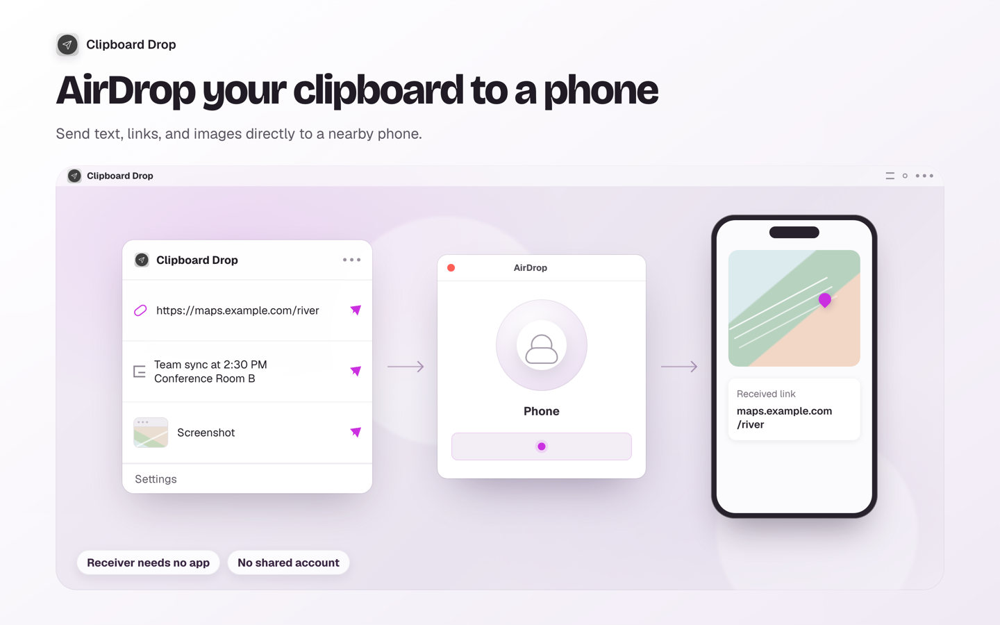

<p align="center"></p>
<h1 align="center">Clipboard Drop</h1>
<p align="center"><strong>AirDrop what you copy to a nearby phone</strong><br>A menu bar app for macOS that sends copied text, links, and images through the system sharing sheet.</p>
<p align="center"><a href="#install">Install</a> · <a href="#how-it-works">How It Works</a> · <a href="#faq">FAQ</a> · <a href="#support">Support</a> · <a href="PRIVACY.md">Privacy</a></p>
<p align="center"></p>

I often need to hand a link, a Wi-Fi password, an address, or a code snippet from my Mac to someone else's phone or tablet. Apple's Universal Clipboard works only between devices signed in to the same Apple Account with Handoff enabled. When you need to send copied text, a link, or a screenshot to a friend or coworker, macOS gives you no direct way to do it. I built Clipboard Drop to solve this: copy anything on your Mac, trigger the app, and AirDrop it to a nearby device through the native AirDrop sheet.

## Features

- **Send text, links, and media** — Send plain text, formatted rich text, web links, images, and screenshots directly from your clipboard.
- **Multiple ways to send** — Trigger transfers from the menu bar, press the global shortcut (⌃⌥⌘C by default), right-click the menu bar icon, drag content onto the icon, use "Send with Clipboard Drop" in the macOS Services menu, or run Shortcuts actions.
- **Edit before sending** — Fix or trim text in a small editor window before the AirDrop sheet opens.
- **Merge recent items** — Select multiple items from your recent history to combine and send them as a single file.
- **Offline QR codes** — Display a QR code for text or links so any phone camera can scan it when AirDrop is unavailable.
- **Private and offline** — Operates without network access, analytics, saved history, or Accessibility permission.
- **Open source and free** — Licensed under the MIT license with no in-app purchases, advertisements, or accounts.

## Install

> Requires macOS 13 Ventura or later.

**[Download on the Mac App Store](https://apps.apple.com/app/id6768068044?pt=128417926&ct=readme)** — free, no in-app purchases.

Or build from source:

```sh
./script/build_and_run.sh
```

## How It Works

1. Copy text, a link, an image, or a screenshot on your Mac.
2. Click the Clipboard Drop menu bar icon or press the global shortcut (⌃⌥⌘C).
3. Choose Send to open the macOS sharing sheet.
4. Select the target device in the AirDrop sheet.

The receiver does not need to install anything and does not need to use the same Apple Account.

| Content | Arrives as |
| --- | --- |
| Text | `.txt` or `.md` |
| Formatted text | `.rtf` (when "Keep formatting" is on) |
| Link | The link itself (or `.txt`/`.url` if you choose a file format) |
| Image or screenshot | `.png` |
| Files dragged onto the icon | The original files |

## FAQ

<details>
<summary><strong>Does the receiver need to install anything?</strong></summary>

No, the receiver does not need to install any app or configure any account. Clipboard Drop invokes Apple's native AirDrop sheet, so any receiving iPhone, iPad, or Mac handles the incoming transfer using its standard built-in system software.
</details>

<details>
<summary><strong>What if the other device does not show up in the AirDrop list?</strong></summary>

Check that the receiving device has Wi-Fi and Bluetooth turned on, with AirDrop set to receive incoming requests. If the recipient is not in your contacts, ask them to set AirDrop to "Everyone for 10 Minutes" in Control Center. On macOS or iOS 26.2 or later, you may also need to enter the AirDrop code shown on the receiver's screen to authenticate the transfer. If the other device does not support AirDrop or belongs to an Android user, select Show QR Code in Clipboard Drop so they can scan the content with their camera.
</details>

<details>
<summary><strong>Does Clipboard Drop sync or store my clipboard history?</strong></summary>

No, Clipboard Drop does not sync your clipboard automatically or store your history on disk. Recent items are kept strictly in memory while the app runs and are cleared completely when you quit. Nothing is written to storage except an ephemeral file created during an active send, which the app deletes after the send. Clipboard Drop also cannot receive items on your Mac or send silently in the background without your confirmation in the system sheet.
</details>

<details>
<summary><strong>Why not just use Apple's Universal Clipboard?</strong></summary>

Universal Clipboard only works between devices signed in to the same Apple Account with Handoff turned on. It cannot transfer anything to another person's iPhone, an office workstation, or any device using a different account. Clipboard Drop uses the native AirDrop sharing sheet instead, so you can hand copied text, links, or screenshots to any nearby device that can receive AirDrop.
</details>

<details>
<summary><strong>Does Clipboard Drop need special permissions or an internet connection?</strong></summary>

No, the app runs completely offline and requires no special system permissions. Clipboard Drop has no network entitlement, collects no telemetry or analytics, and requires no Accessibility or Screen Recording permissions.
</details>

<details>
<summary><strong>Is Clipboard Drop really free?</strong></summary>

Yes, Clipboard Drop is free forever with no in-app purchases, advertisements, or accounts. The project is completely open source under the MIT license.
</details>

## Support

Clipboard Drop is free and there is nothing to buy. If you would like to support my work, here are the best ways to help:

- Use it and tell someone who might find it helpful.
- Star the repository on [GitHub](https://github.com/Feng6611/mac-airdrop-clipboard).
- Follow me on [GitHub](https://github.com/Feng6611).
- Rate or review the app on the [Mac App Store](https://apps.apple.com/app/id6768068044?action=write-review).
- Try my other app, [Command Reopen](https://apps.apple.com/app/id6757333924?pt=128417926&ct=clipdrop-readme), which brings back minimized windows when you switch to an app with Cmd-Tab.

## Development

```sh
# Build & run
./script/build_and_run.sh

# Verify build
./script/build_and_run.sh --verify

# Run tests
xcodebuild test -project ClipDrop.xcodeproj -scheme ClipDrop \
  -destination 'platform=macOS,arch=arm64'
```

See [Docs/Architecture.md](Docs/Architecture.md) for the codebase structure.

## About

Built by [chenfeng](https://github.com/Feng6611) — I make small, permission-light Mac utilities. More: [Command Reopen](https://commandreopen.com) · [Obsidian plugins](https://github.com/Feng6611)

## Privacy

Clipboard Drop collects no user data, operates completely offline without network permissions, and keeps history only in memory while running; see [PRIVACY.md](PRIVACY.md) for details.

## License

[MIT](LICENSE)
